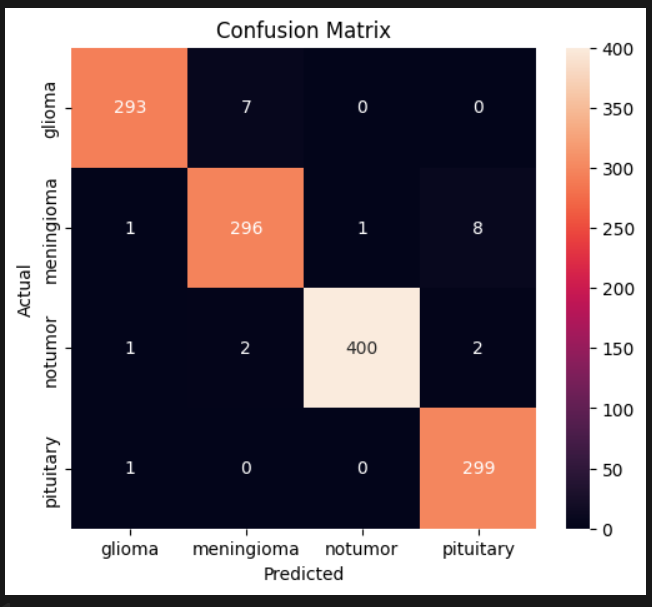
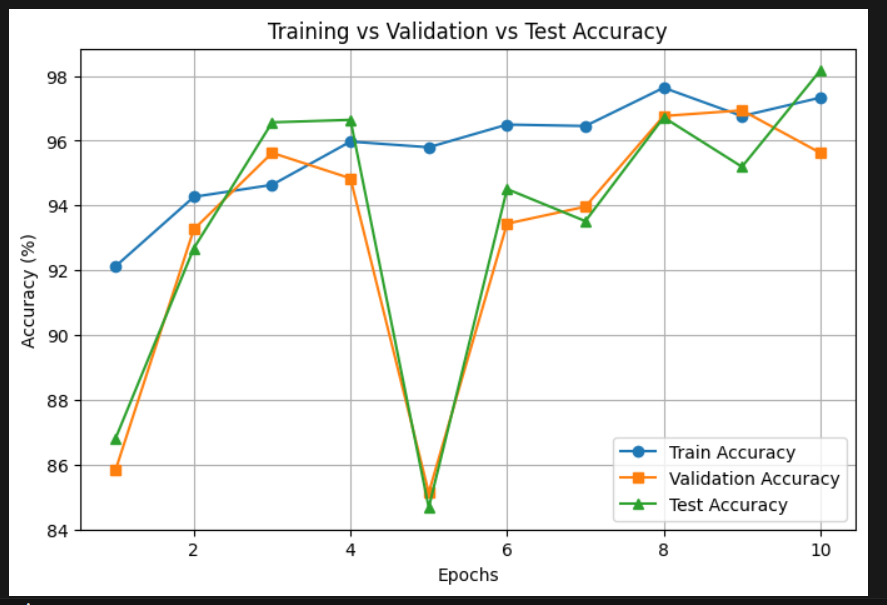
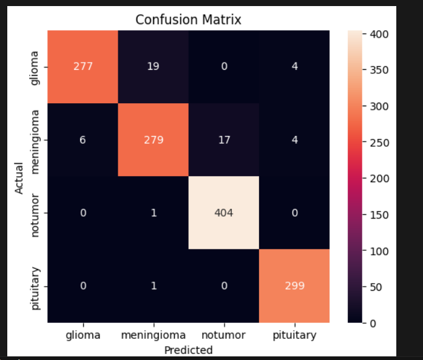
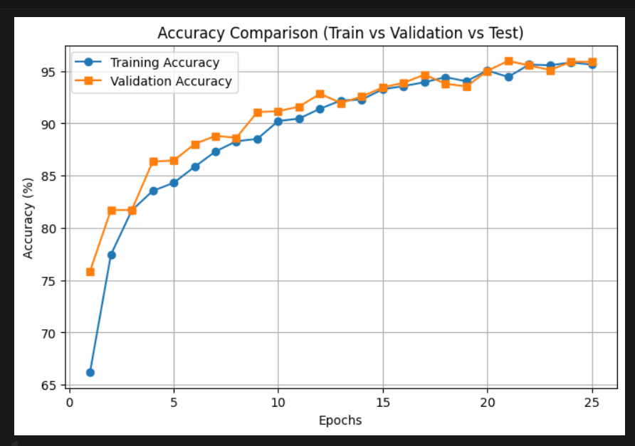

<div align="center">


<p>
  
  
  
  
  
</p>

**[Web demo](https://neuroassistai.vercel.app)** · [Reference paper](https://link.springer.com/article/10.1007/s10278-025-01686-1) · [Dataset](https://www.kaggle.com/datasets/masoudnickparvar/brain-tumor-mri-dataset)

</div>

---

## The question

Do you need a large, pretrained network to classify brain tumours from MRI, or can a small CNN trained from scratch do almost as well? We reproduced the idea of the paper *Lightweight Transfer Learning Models for Multi-Class Brain Tumor Classification* and tested it ourselves, as a Computer Vision course project at NUML.

Both models sort an MRI scan into one of four classes: **glioma, meningioma, pituitary tumour or no tumour**.

This repo is the transfer-learning extension of [NeuroAssistAI](https://github.com/21Afnan/NeuroAssistAI), our rebuild of a brain tumour diagnosis study, and the best model powers the same [web demo](https://neuroassistai.vercel.app).

## Results

| Model | Training | Test accuracy |
|---|---|:---:|
| Custom CNN (from scratch) | 25 epochs, Adam, lr 0.001 | 92% to 94% |
| **ResNet-18 (fine-tuned)** | 10 epochs, AdamW, lr 0.001 | **96% to 97%** |

**Takeaway:** the pretrained ResNet-18 is more accurate and reaches its best result in fewer epochs, while the small CNN stays competitive and is much cheaper to run, a useful option where compute is limited.

<table>
<tr>
<td align="center"><b>ResNet-18 confusion matrix</b><br/></td>
<td align="center"><b>ResNet-18 accuracy curve</b><br/></td>
</tr>
<tr>
<td align="center"><b>CNN confusion matrix</b><br/></td>
<td align="center"><b>CNN accuracy curve</b><br/></td>
</tr>
</table>

Loss curves and full classification reports are in [`results/`](results), and sample predictions for every class are in [`predicted samples_screenshots/`](predicted%20samples_screenshots).

## Method

| Step | Custom CNN | ResNet-18 |
|---|---|---|
| Input | Grayscale MRI | MRI (3 channels) |
| Augmentation | Random horizontal flip, rotation up to 15 degrees, resize | Same |
| Split | Train and validation (random split) plus a held-out test set | Same |
| Architecture | 3 conv blocks (32, 64, 128 filters), dense layer of 256, 4-class output | ImageNet-pretrained ResNet-18 with a new 4-class head |
| Batch size | 32 | 32 |
| Saved weights | `models/brain_tumor_cnn.pth` | `models/brain_tumor_resnet18.pth` |

## Run it

```bash
git clone https://github.com/21Afnan/TumorSense-AI.git
cd TumorSense-AI
pip install -r requirements.txt
```

Open either notebook in Jupyter or Google Colab and run all cells. The dataset downloads through `kagglehub`.

- `src_code/..._CNN_code.ipynb`: train and evaluate the custom CNN
- `src_code/..._Resnet_code.ipynb`: fine-tune and evaluate ResNet-18

To skip training, load the weights from `models/` directly.

## Repository contents

```
TumorSense-AI/
├── src_code/                        # CNN and ResNet-18 notebooks
├── models/                          # trained weights (.pth)
├── results/                         # curves, confusion matrices, reports
├── predicted samples_screenshots/   # sample predictions per class
├── Research Paper/                  # reference paper
├── docx/                            # project report and code printouts
└── requirements.txt
```

## Team

| Member | GitHub | LinkedIn |
|---|---|---|
| **Afnan Shoukat** | [21Afnan](https://github.com/21Afnan) | [Afnan Shoukat](https://www.linkedin.com/in/afnanshoukat) |
| Hina Tanveer | [hinatanveer](https://github.com/hinatanveer) | [Hina Tanveer](https://www.linkedin.com/in/hinatanveer3810) |
| Usama Shahid | [fewgets](https://github.com/fewgets) | [Usama Shahid](https://linkedin.com/in/-usamashahid) |
| Dur-e-Adan Noor | [dureadannoor-123](https://github.com/dureadannoor-123) | [Dur-e-Adan Noor](https://www.linkedin.com/in/dure-adan-noor-29b01b2b5) |
| Salman Khan | [S4lmankhan](https://github.com/S4lmankhan) | [Salman Khan](https://www.linkedin.com/in/s4lmankhan) |

> Research and learning project only; not a medical device.

---

<div align="center">

<a href="mailto:afnanshoukat35@gmail.com"></a>
<a href="https://www.linkedin.com/in/afnanshoukat"></a>
<a href="https://github.com/21Afnan"></a>

Released under the [MIT License](LICENSE).

</div>

